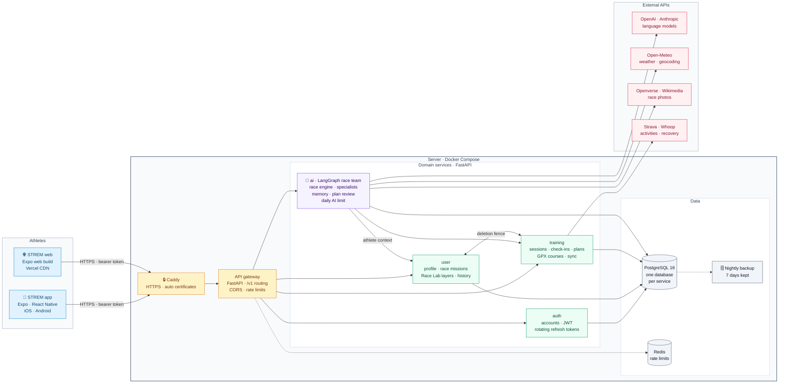
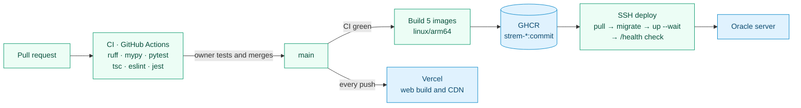

# STREM

**The AI race team for self-coached trail runners.** You commit to a race; STREM
turns your training data, your race and what you tell it into a week-by-week plan,
a race-day kit (fuel, gear, logistics, strategy) and a race team you can talk to.

The name comes from the Bulgarian *стремеж* — striving, upward movement.

## What it does

- **Race Mission** — pick a race (date, distance, climbing, checkpoints) and a goal.
- **Training plan** — built from your race and the training you already do, adapted
  when you miss sessions (every change waits for your review).
- **Race Lab** — course analysis from your GPX, plus fuel, gear, logistics and a
  checkpoint-by-checkpoint race strategy.
- **Race team** — specialists (coach, fuel, course, gear, logistics) that answer
  from your own data and remember what you tell them.
- **Race-day mode** — an offline race pack with live station cues; the finish feeds
  the debrief and your race history.
- **Your data** — export or delete everything, including your account.

## Architecture



**How a request flows.** The app sends every call to one public address. Caddy
terminates HTTPS and hands it to the gateway, which rate-limits per client and token
and forwards `/v1/<area>/…` to the service that owns that data. Services never read
each other's databases: the AI service reads the athlete's missions, plans and
check-ins through the other services' APIs, using the athlete's own token, so it can
only ever see what that athlete can see.

**How the race team thinks.** A deterministic race engine always builds the plan and
every Race Lab layer first. When an AI provider is available, a LangGraph graph routes
the question to specialists (coach, fuel, course, gear, logistics) that answer from the
athlete's data and long-term memory, and a review graph pauses every plan change until
the athlete approves it. Every output carries its origin (engine, AI or athlete), and
without an API key, credit or daily allowance the engine carries on and the app says so.

### Delivery



### Code layout

| Path | What it is | Database |
|---|---|---|
| `apps/mobile` | Expo / React Native app for iOS, Android and web | — |
| `services/gateway` | The single public API: routes `/v1/*`, CORS, rate limits | Redis |
| `services/auth` | Accounts, JWT access tokens, rotating refresh tokens | `strem_auth` |
| `services/user` | Profile, race missions, Race Lab layers, race history, legal acceptance | `strem_user` |
| `services/training` | Sessions, check-ins, plans, GPX courses, Strava and Whoop | `strem_training` |
| `services/ai` | LangGraph race team, race engine, memory, daily AI limit (OpenAI or Anthropic) | `strem_ai` |
| `deploy/` | Docker Compose (local and production), Caddy, scripts (migrate, seed, backup) | — |
| `docs/` | Product description and legal texts | — |

Each service owns its database and its schema migrations (Alembic, one initial
revision plus whatever comes after it).

## Run it yourself

There is no public STREM server at the moment, so run your own. Everything runs on
one computer with Docker, and the AI race team uses your own API key, so you pay
your provider directly. The production setup in [`deploy/`](deploy/README.md) is
ready but switched off until a server is configured.

### 1. Install

- Docker with Compose v2 (Docker Desktop on Windows and macOS)
- Node 20 or newer
- Python 3.11 or newer (the scripts in `deploy/scripts` need only the standard library)

### 2. Configure

```bash
git clone https://github.com/baldzhiyski/strem.git
cd strem
cp deploy/.env.example deploy/.env
```

Then edit `deploy/.env`. No key is required: without one, the rule-based race
engine builds the plan and every Race Lab layer, and the app says when the AI was
not used. Add what you want:

| Setting | What it turns on | Where to get it |
|---|---|---|
| `OPENAI_API_KEY` and `AI_PROVIDER=openai` | The AI race team: chat, plans and Race Lab written for you, plan review, reading imported plans | [platform.openai.com/api-keys](https://platform.openai.com/api-keys). Set a monthly budget there too. |
| `OPENAI_MODEL` | The OpenAI model (default `gpt-6.1-sol`) | |
| `ANTHROPIC_API_KEY`, `RACE_MODEL` | The same with Claude: set `AI_PROVIDER=anthropic` | [console.anthropic.com](https://console.anthropic.com) |
| `AI_DAILY_LIMIT` | Model calls per athlete per day (default 60, `0` = no limit). Past it, the rule-based engine carries on | |
| `COVER_IMAGE_EMAILS` | AI-painted race covers, only for these account emails (comma-separated). Uses the OpenAI key; each image counts toward the daily limit | Your account's email |
| `INTEGRATIONS_ENCRYPTION_KEY` | Required before Strava can be connected: encrypts the OAuth tokens | `python -c "import base64,os; print(base64.urlsafe_b64encode(os.urandom(32)).decode())"` |
| `STRAVA_CLIENT_ID`, `STRAVA_CLIENT_SECRET` | Strava activities in your training log, Strava races in your race history | See [Strava](#strava) |
| `JWT_SECRET` | Signs logins. Fine as is on your own computer; set a long random value if other people can reach it | `python -c "import secrets; print(secrets.token_urlsafe(48))"` |

Weather, place search and race photos (Open-Meteo, Openverse, Wikimedia) need no
keys. Whoop sync exists in the training service (`WHOOP_CLIENT_ID`,
`WHOOP_CLIENT_SECRET`), but the app has no Whoop connect button yet.

### 3. Start the backend

```bash
docker compose --env-file deploy/.env -f deploy/docker/docker-compose.yml up -d --build --wait
python deploy/scripts/migrate-stack.py    # database migrations
python deploy/scripts/smoke-health.py     # every service answers
python deploy/scripts/seed-demo.py        # optional: demo athlete race-demo@strem.app / NeverSettle123!
```

The API is at `http://localhost:8000/v1`. After you change `deploy/.env`, run the
`up` command again so the services pick it up.

### 4. Start the app

In the browser:

```bash
cd apps/mobile
npm ci
npx expo start --web
```

The app talks to `http://localhost:8000/v1` unless you set `EXPO_PUBLIC_API_URL`.
Any `localhost` port works: if 8081 is taken, Expo picks another one.

On your phone: install Expo Go, put the phone on the same Wi-Fi as your
computer, and start Expo with your computer's address so the phone can reach the
API:

```bash
EXPO_PUBLIC_API_URL=http://192.168.1.20:8000/v1 npx expo start   # your computer's LAN IP
```

Scan the QR code with Expo Go (iOS: the camera app). Restart Expo after changing
any `EXPO_PUBLIC_*` setting.

### Strava

1. Create an app at [strava.com/settings/api](https://www.strava.com/settings/api).
   Set **Authorization Callback Domain** to `localhost`.
2. Put its Client ID and Client Secret into `deploy/.env` as `STRAVA_CLIENT_ID` and
   `STRAVA_CLIENT_SECRET`, set `INTEGRATIONS_ENCRYPTION_KEY`, and run the `up`
   command again.
3. Start the web app with the same Client ID (it is public; the secret stays on
   the server):

   ```bash
   EXPO_PUBLIC_STRAVA_CLIENT_ID=12345 npx expo start --web
   ```

4. In the app: **You → Connected sources → Connect Strava**. The first sync imports
   up to a year of activities.

A new Strava app works for your own Strava account; Strava has to approve it
before other athletes can connect.

### If something doesn't work

- **The app says the AI is offline:** the key is missing or has no credit, or the
  athlete reached `AI_DAILY_LIMIT` for today. `docker compose --env-file deploy/.env -f deploy/docker/docker-compose.yml logs ai` shows which.
- **"Strava isn't configured in this build":** start Expo with
  `EXPO_PUBLIC_STRAVA_CLIENT_ID`.
- **Connecting Strava fails:** check `INTEGRATIONS_ENCRYPTION_KEY` and that the
  callback domain is exactly `localhost`.
- **Start from zero:** `docker compose --env-file deploy/.env -f deploy/docker/docker-compose.yml down -v`
  deletes every container and all data.

## Tests

- Services: `cd services/<name> && pip install -r requirements.txt -r requirements-dev.txt && ruff check . && mypy . && pytest`
- App: `cd apps/mobile && npm ci && npx tsc --noEmit && npm run lint && npm test`
- End to end (starts every service on SQLite): `cd apps/mobile && npx playwright test`

CI runs all of this on every pull request.

## License

[MIT](LICENSE)
